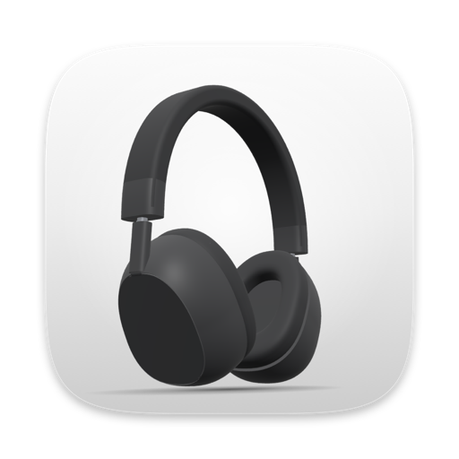
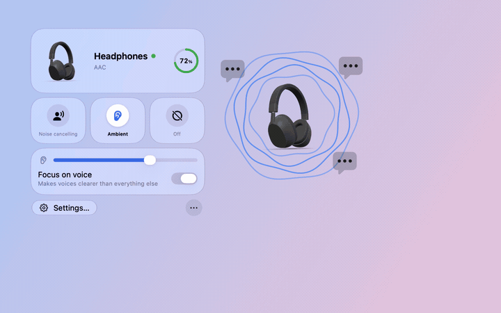
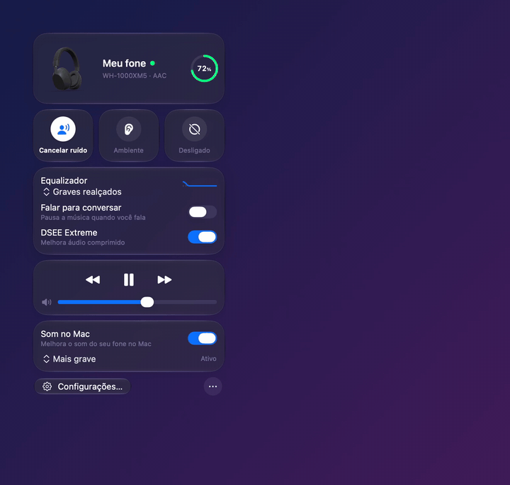

<p align="center"></p>

<h1 align="center">Quietbar</h1>

<p align="center">
Control your Sony headphones (WH-1000XM5, WF-1000XM5, LinkBuds…) from the macOS menu bar, without the phone app.<br>
<a href="README.md">Português</a>
</p>

<p align="center">
<a href="https://github.com/raphaeltorquat0/Quietbar/releases/latest"><b>⬇︎ Download the latest version (.dmg)</b></a>
</p>

<p align="center">
<a href="docs/media/automation/automation-16x10-dark-en.mp4">
<picture>
  <source media="(prefers-reduced-motion: reduce) and (prefers-color-scheme: dark)" srcset="docs/media/automation/automation-16x10-dark-en.png">
  <source media="(prefers-reduced-motion: reduce)" srcset="docs/media/automation/automation-16x10-light-en.png">
  <source media="(prefers-color-scheme: dark)" srcset="docs/media/automation/automation-16x10-dark-en.gif">
  
</picture>
</a>
</p>

Quietbar is a native Swift/SwiftUI app that speaks the Sony MDR v2 protocol directly over Bluetooth (RFCOMM). Your settings stay on your Mac, and there's no account. It uses the internet for the update check, which you can turn off, and for anonymous metrics, opt-in, off by default ([what is collected, in Portuguese](docs/PRIVACY.md), and the [schema](docs/telemetry-schema.md)).

> Independent project. **Not affiliated with, endorsed by or supported by Sony.**
> "Sony", "WH-1000XM5", "WF-1000XM5", "LinkBuds" and other model names are trademarks of their respective owners, used only to indicate compatibility.

## Features

- Sound mode (noise canceling, ambient, off), ambient level and voice focus
- Equalizer, DSEE, Speak-to-Chat, auto pause and auto power off
- Multipoint, touch panel, connection priority, volume and media controls
- **Mac Sound:** improves your headphones' sound on your Mac, with a parametric EQ of up to 10 filters, A/B comparison and curves imported from AutoEQ. It only affects audio from your Mac and doesn't change noise canceling or the sound on your phone. It asks for the System Audio Recording permission; audio is processed in memory and nothing is recorded or sent ([details, in Portuguese](docs/AUDIO.md))
- Battery in the menu bar, with a low battery alert
- Global shortcuts and automatic profiles by foreground app or Wi-Fi network
- **[Automation](#automation):** sound mode during calls, profiles per Focus, and actions in the Shortcuts app
- Connection popup with a procedurally generated 3D model
- Liquid Glass on macOS 26 and later, in the style of Control Center
- Light and dark mode, VoiceOver, English and Brazilian Portuguese

The app only shows what your headphones report at connection. It runs on macOS 14 or later, on Apple Silicon and Intel.

<p align="center"></p>

## Compatibility

| Status | Headphones | What it means |
|---|---|---|
| **Tested on hardware** | WH-1000XM5 (firmware 2.5.1) | Full read session on a real unit. Write commands are still going through [`docs/HARDWARE_TEST.md`](docs/HARDWARE_TEST.md) |
| **Validated with real traffic** | WF-1000XM5 (fw 6.1.0), LinkBuds Clip / WF-LC900 (fw 2.0.3) | The app understands public captures from these models, but hasn't been used with them |
| **Experimental** (known protocol, untested) | WH-1000XM6, WH-CH720N, ULT WEAR, WF-1000XM6, WF-C510, WF-C700N, WF-C710N, LinkBuds S, LinkBuds Open | Public sources point to MDR v2, but Quietbar has never run with them |
| **Unverified** (may be MDR v1) | WF-1000XM4, WF-C500, LinkBuds | No source confirms the protocol version. They may not work |
| **On the roadmap** (MDR v1) | WH-1000XM4/XM3/XM2, WF-1000XM3, WF-SP800N | They use the older protocol, which isn't implemented yet |

**Do you own one of these?** Please test it and [send a report](https://github.com/raphaeltorquat0/Quietbar/issues/new?template=relatorio-de-fone.yml). That's what moves a model out of "experimental" or "unverified".

The reference profiles in the [simulator](docs/SIMULATOR.md) only test the interface, because their frames are generated by MDRKit itself. They don't show that a headphone works.

## Install

**Homebrew:**

```sh
brew install --cask raphaeltorquat0/tap/quietbar
```

**Download:** get `Quietbar-<version>.dmg` from [Releases](https://github.com/raphaeltorquat0/Quietbar/releases/latest) and drag Quietbar to **Applications**.

Either way, macOS blocks the first launch because the app isn't notarized by Apple yet:

1. Try to open Quietbar. Close the warning with **OK** or **Done**, not **Move to Trash**.
2. Go to **System Settings › Privacy & Security** and scroll to **Security**.
3. Click **Open Anyway** next to Quietbar and confirm with your password.

On macOS 14, Control-click › **Open** also works. Since macOS 15, only System Settings can approve the app. You only do this once.

Then allow **Bluetooth** access when macOS asks. Your headphones need to be paired with the Mac.

### Build from source

```sh
git clone https://github.com/raphaeltorquat0/Quietbar.git && cd Quietbar
make install
```

Requires macOS 14 or later and Xcode 26 or later.

## Automation

In **Settings › Automation**, each trigger turns on and off separately. The panel shows which rule is in effect.

- **Calls** (off by default): when any app uses the microphone, the headphones switch to the mode you choose, and the previous mode comes back afterwards. It works with Zoom, Meet, Teams, FaceTime, Slack and anything else, because Quietbar watches the microphone, not app names. It only sees whether the input is in use: it doesn't listen to the audio or ask for a permission. Short peaks are ignored (3 s by default), and dictation or recorders can go on the ignored apps list, on macOS 14.2 and later.
- **Focus:** in System Settings › Focus, choose a Focus and add Quietbar under Focus Filters to link a profile to it. Profiles created with "Sem gatilho" (no trigger) are meant for this. If the system doesn't report the change, the app notices within 30 s.
- **Per-app and Wi-Fi profiles:** as before, except that settings now go back when the profile stops applying. Per-app profiles apply after 400 ms and go back after 6 s, so Cmd-Tab and quick trips to another app don't change the mode.
- **Shortcuts app and Siri:** set noise mode, set ambient level, apply profile, apply EQ preset and check the battery, in English and Portuguese.

When two rules set the same thing, the first one in this list wins: manual setting › call › Focus › per-app profile › Wi-Fi profile › default. Each rule only decides what it sets: a call that changes the mode keeps the profile's ambient level. "Default" is the value from before a rule changed it.

A manual change, including the button on the headphones, lasts until the rule in effect changes. Switching to an app without a profile doesn't count. With the panel closed for more than 15 s the channel is released and the headphones don't report the physical button: Quietbar notices when the channel reopens and keeps your change until the next rule change.

Automation has been [validated on a WH-1000XM5](docs/validation/1.4.0-sim.md), but not yet with Meet, Zoom, a real Focus or the Shortcuts app. The test script is in [`MANUAL_TEST.md`](MANUAL_TEST.md). Both documents are in Portuguese.

## Metrics

Anonymous metrics, opt-in, off by default. If you turn them on, the app sends at most one summary per finished day: a random ID replaced every 90 days, the date, app and macOS versions, architecture, the headphone model from a known list and usage counters capped at 50: manual mode changes by source, automation triggers, changes against a rule and panel opens. It never includes headphone, network, app, Focus or profile names. Nothing is sent on Low Data Mode networks, an unsent report is dropped after 3 days, and the server deletes each report after 400 days without storing the IP. With no server configured in the build, nothing is sent. Settings › Privacy turns this on and off and shows the exact JSON of the next report; turning it off erases what's on your Mac. See the [schema](docs/telemetry-schema.md).

## Updates

The app checks for a new version once a day with [Sparkle](https://sparkle-project.org). The check reads a file on GitHub Pages, which sees your IP address like any web request, and no headphone or Mac data is sent. Every update is verified with an EdDSA signature. To turn it off, go to Settings › General. To check right away, right-click the icon.

## For developers

- [`Packages/MDRKit`](Packages/MDRKit/README.md): the protocol as a standalone Swift package
- [`docs/PROTOCOL.md`](docs/PROTOCOL.md): protocol reference with sources, in Portuguese
- [`DECISIONS.md`](DECISIONS.md): design decisions, in Portuguese
- [`CONTRIBUTING.md`](CONTRIBUTING.md): how to contribute

## Out of scope

Firmware updates, voice guide language, 360 Reality Audio and Sony account features. They need Sony's servers or an undocumented write flow.

## Credits

The protocol was studied from open projects, cited item by item in `docs/PROTOCOL.md`: [SonyHeadphonesClient](https://github.com/mos9527/SonyHeadphonesClient) (MIT), [sony-headphones-linux](https://github.com/vyomjain6904/sony-headphones-linux) (MIT) and [Gadgetbridge](https://codeberg.org/Freeyourgadget/Gadgetbridge) (AGPL, used only as a behavior reference, with no code copied).

[Sparkle](https://github.com/sparkle-project/Sparkle) (MIT) handles updates, and its license notice ships with the app.

## License

[MIT](LICENSE) © Raphael Torquato
