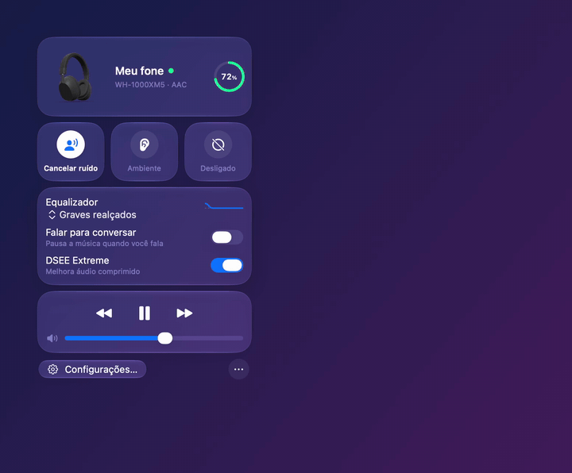

<p align="center"></p>

<h1 align="center">Quietbar</h1>

<p align="center">
Control your Sony headphones (WH-1000XM5, WF-1000XM5, LinkBuds…) from the macOS menu bar, without the phone app.<br>
<a href="README.md">Português</a>
</p>

<p align="center">
<a href="https://github.com/raphaeltorquat0/Quietbar/releases/latest"><b>⬇︎ Download the latest version (.dmg)</b></a>
</p>

<p align="center">

</p>

Quietbar is a native Swift/SwiftUI app that speaks the Sony MDR v2 protocol directly over Bluetooth (RFCOMM). Nothing goes through the internet, and there's no account.

> Independent project. **Not affiliated with, endorsed by or supported by Sony.**
> "Sony", "WH-1000XM5", "WF-1000XM5", "LinkBuds" and other model names are trademarks of their respective owners, used only to indicate compatibility.

## Features

- Sound mode (noise canceling, ambient, off), ambient level and voice focus
- Equalizer, DSEE, Speak-to-Chat, auto pause and auto power off
- Multipoint, touch panel, connection priority, volume and media controls
- Battery in the menu bar, with a low battery alert
- Global shortcuts and automatic profiles by foreground app or Wi-Fi network
- Connection popup with a procedurally generated 3D model
- Liquid Glass on macOS 26 and later, in the style of Control Center
- Light and dark mode, VoiceOver, English and Brazilian Portuguese

The app only shows what your headphones report at connection. It runs on macOS 14 or later, on Apple Silicon and Intel.

## Compatibility

| Headphones | Status |
|---|---|
| WH-1000XM5 | **Tested on hardware** (firmware 2.5.1) |
| WF-1000XM5, LinkBuds Clip (WF-LC900) | Validated with recorded real traffic |
| WH-1000XM6, WH-CH720N, ULT WEAR, WF-1000XM4/XM6, WF-C500/C510/C700N/C710N, LinkBuds, LinkBuds S/Open | **Experimental:** same protocol, not tested yet |
| WH-1000XM4/XM3/XM2, WF-1000XM3, WF-SP800N | **On the roadmap:** they use the older MDR v1 protocol |

**Do you own an experimental model?** Please test it and [send a report](https://github.com/raphaeltorquat0/Quietbar/issues/new?template=relatorio-de-fone.yml). That's what turns "experimental" into "tested".

## Install

**Homebrew:**

```sh
brew install --cask raphaeltorquat0/tap/quietbar
```

**Download:** get `Quietbar-<version>.dmg` from [Releases](https://github.com/raphaeltorquat0/Quietbar/releases/latest) and drag Quietbar to **Applications**.

Either way, macOS blocks the first launch because the app isn't notarized by Apple yet:

1. Try to open Quietbar and close the warning. Don't move the app to the Trash.
2. Go to **System Settings › Privacy & Security** and scroll to **Security**.
3. Click **Open Anyway** next to Quietbar and confirm with your password.

On macOS 14, Control-click › **Open** also works. Since macOS 15, only System Settings can approve the app. You only do this once.

Then allow **Bluetooth** access when macOS asks. Your headphones need to be paired with the Mac.

### Build from source

```sh
git clone https://github.com/raphaeltorquat0/Quietbar.git && cd Quietbar
make install
```

Requires macOS 14 or later and Xcode 26 or later.

## For developers

- [`Packages/MDRKit`](Packages/MDRKit/README.md): the protocol as a standalone Swift package
- [`docs/PROTOCOL.md`](docs/PROTOCOL.md): protocol reference with sources, in Portuguese
- [`DECISIONS.md`](DECISIONS.md): design decisions, in Portuguese
- [`CONTRIBUTING.md`](CONTRIBUTING.md): how to contribute

## Out of scope

Firmware updates, voice guide language, 360 Reality Audio and Sony account features. They need Sony's servers or an undocumented write flow.

## Credits

The protocol was studied from open projects, cited item by item in `docs/PROTOCOL.md`: [SonyHeadphonesClient](https://github.com/mos9527/SonyHeadphonesClient) (MIT), [sony-headphones-linux](https://github.com/vyomjain6904/sony-headphones-linux) (MIT) and [Gadgetbridge](https://codeberg.org/Freeyourgadget/Gadgetbridge) (AGPL, used only as a behavior reference, with no code copied).

## License

[MIT](LICENSE) © Raphael Torquato
