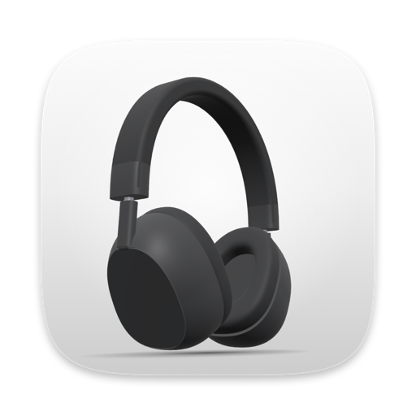
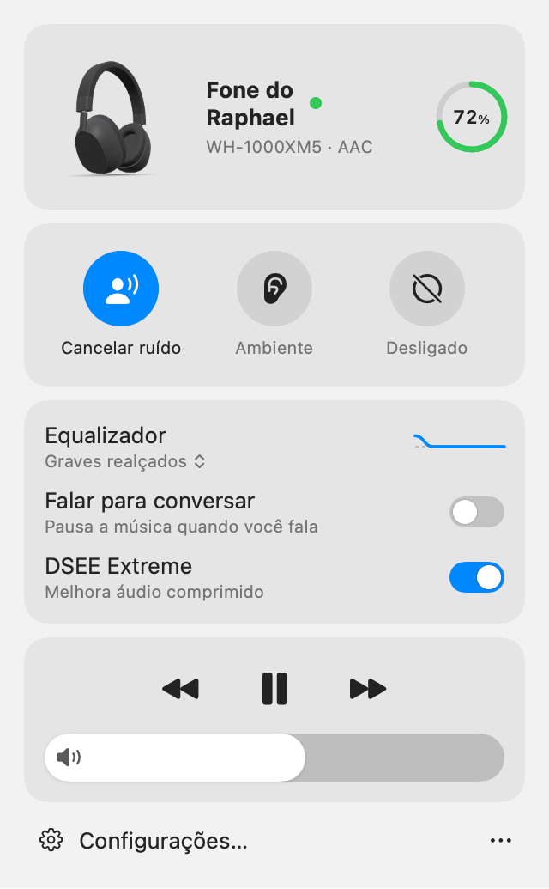
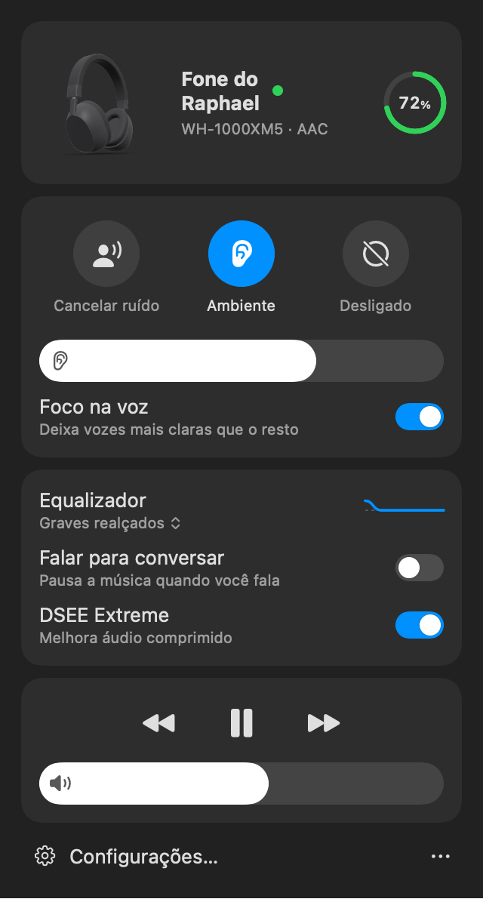

<p align="center"></p>

<h1 align="center">Quietbar</h1>

<p align="center">
Controle seus fones <b>Sony</b> (WH-1000XM5, WF-1000XM5, LinkBuds…) pela barra de menus do macOS, sem o app da Sony no celular.<br>
<i>Control your Sony headphones from the macOS menu bar — native, private, no phone app needed.</i>
</p>

<p align="center">
<a href="https://github.com/raphaeltorquat0/Quietbar/releases/latest"><b>⬇︎ Baixar a última versão (.dmg)</b></a>
</p>

<p align="center">

&nbsp;&nbsp;

</p>

App nativo em Swift/SwiftUI que fala o protocolo Sony MDR v2 direto pelo Bluetooth (RFCOMM).
Nada passa pela internet.

> Projeto independente. **Não é afiliado, endossado nem suportado pela Sony.**
> "Sony" e "WH-1000XM5" são marcas da Sony Group Corporation.

## O que faz

- Modo de som (cancelamento de ruído / ambiente / desligado), nível do ambiente, foco na voz
- Equalizador (presets e curva de 5 bandas + Clear Bass), DSEE, Falar para conversar, pausa e desligamento automáticos
- Multiponto, painel de toque, prioridade de conexão, volume e controle de mídia
- Bateria na barra de menus, com alerta de bateria baixa
- Atalhos globais e perfis automáticos por app em primeiro plano ou rede Wi-Fi
- Popup animado ao conectar, com um modelo 3D do fone gerado em código
- Modo claro e escuro, cor de destaque do sistema, VoiceOver, PT-BR e inglês

O app só mostra o que o fone anuncia na conexão. macOS 14 ou mais novo, Apple Silicon e Intel.

## Compatibilidade

| Fone | Status |
|---|---|
| WH-1000XM5 | **Testado em hardware** (firmware 2.5.1) |
| WF-1000XM5 | Validado com tráfego real gravado (fw 6.1.0): bateria esquerda/direita + estojo, cancelamento de ruído, EQ |
| LinkBuds Clip (WF-LC900) | Validado com tráfego real gravado (fw 2.0.3): sem cancelamento de ruído, EQ de 10 bandas |
| WH-1000XM6, WH-CH720N, ULT WEAR, WF-1000XM4/XM6, WF-C500/C510/C700N/C710N, LinkBuds, LinkBuds S/Open | Experimental: mesmo protocolo (MDR v2), ainda sem teste |
| WH-1000XM4/XM3/XM2, WF-1000XM3, WF-SP800N | Ainda não: usam a versão antiga do protocolo (MDR v1) |

Tem um desses fones? [Abra uma issue](https://github.com/raphaeltorquat0/Quietbar/issues/new?template=novo-modelo.md)
com o diagnóstico da aba Desenvolvedor; é o que transforma "experimental" em "testado".

## Instalar

1. Baixe o `Quietbar-<versão>.dmg` em [Releases](https://github.com/raphaeltorquat0/Quietbar/releases/latest)
   e arraste o Quietbar para **Aplicativos**.
2. Abra o Quietbar. Como o app não é notarizado pela Apple (é um projeto independente, sem conta de
   desenvolvedor paga), o macOS bloqueia a primeira abertura. Vá em **Ajustes do Sistema › Privacidade e
   Segurança**, role até o aviso do Quietbar e clique em **Abrir Mesmo Assim**. Isso só é preciso uma vez.
   <br>Pelo Terminal, o equivalente é `xattr -dr com.apple.quarantine /Applications/Quietbar.app`.
3. Permita o acesso ao **Bluetooth** quando o macOS pedir. O fone precisa estar pareado com o Mac.

O ícone de fone aparece na barra de menus. Para abrir junto com o Mac: Configurações › Geral ›
"Abrir ao iniciar sessão".

### Compilar do código

```sh
git clone https://github.com/raphaeltorquat0/Quietbar.git && cd Quietbar
make install
```

Compila, assina localmente, instala em `/Applications/Quietbar.app` (fechando a versão anterior), liga
"abrir ao iniciar sessão" e abre o app. Requisitos: macOS 14+ e Xcode 16+;
[XcodeGen](https://github.com/yonaskolb/XcodeGen) (`brew install xcodegen`) só se você mudar o `project.yml`.

Para desenvolver: `make dev` (roda o app em Debug no terminal), `make test` (todos os testes),
`make dmg` (gera o `.dmg` de distribuição pelo `scripts/release.sh`; `SIGN_IDENTITY` e
`NOTARY_PROFILE` assinam com Developer ID e notarizam). `make` sozinho lista os alvos.

## Barra de menus

Clique no ícone para abrir o painel (modo de som, nível de ambiente, equalizador, Speak-to-Chat,
DSEE). Clique direito: Conectar/Desconectar, Configurações, Sair. **Option-clique** adiciona
"Ferramentas de desenvolvedor…". No macOS 26+ há também um botão "Modo de som do fone" para a
Central de Controle (com o app aberto).

## Permissões

| Permissão | Por quê |
|---|---|
| Bluetooth | falar com o fone. Na CLI, quem pede é o Terminal — reinicie o Terminal depois de autorizar. |
| Localização (opcional) | o macOS só revela o nome da rede Wi-Fi a apps com localização; usado apenas nos perfis por Wi-Fi |
| Notificações (opcional) | alerta de bateria baixa |

Build ad-hoc: na primeira abertura, libere o app em **Ajustes › Privacidade e Segurança**.

## Ferramentas de debug: aba Desenvolvedor

Em **Configurações › Desenvolvedor** (ative em Configurações › Geral › "Mostrar a aba Desenvolvedor",
ou Option-clique no ícone da barra › "Ferramentas de desenvolvedor…"):

- **Diagnóstico**: versão do app, macOS, firmware, capacidades detectadas e "Copiar diagnóstico"
  para colar em issues.
- **Testar popup**: com os dados do fone, ou fictícios se ele estiver desconectado.
- **Modelo 3D ao vivo**: estado NC/Ambiente/Off, bateria, reduzir movimento, "Repetir entrada" e
  "Exportar USDZ…".
- **Procurar fone em modo de pareamento**: instruções, 20 s de busca BLE com resultados ao vivo
  (nome, RSSI, Fast Pair) e "Copiar resultado".
- **Log do protocolo MDR** em tempo real (hex + mensagem decodificada), com filtro, pausar, copiar
  e exportar.

O modelo 3D é gerado em Swift (`Packages/HeadphoneModel`), sem arquivos de malha, com proporções
tiradas de vistas de referência do WH-1000XM5 (não incluídas no repositório). Os testes renderizam
cada estado offscreen e conferem o resultado.

### `mdr-cli` (CI e uso avançado)

Nada do dia a dia precisa dele. `swift build -c release` gera `.build/release/mdr-cli`, com
`list`, `dump`, `get`, `set`, `send`, `sniff`, `popup`, `ble-scan` e `model` (export/snapshot).
`--log-hex` imprime cada frame em stderr. O ícone do app é gerado do modelo 3D com
`mdr-cli model --icon App/Resources/Assets.xcassets/AppIcon.appiconset`. `mdr-cli` sem argumentos mostra a ajuda.

## Limitações

- Detecção "fone por perto" não existe: o XM5 não anunciou um model ID Fast Pair conectado (ver `DECISIONS.md` #18).
- Earbuds usam um símbolo no lugar do modelo 3D (que é de um fone over-ear).
- O XM5 não tem botão personalizável (função `0xF3`) nem envia nomes de presets de EQ.
- Os comandos de escrita foram validados contra um fone simulado; o roteiro de conferência
  em aparelho real está em [`docs/HARDWARE_TEST.md`](docs/HARDWARE_TEST.md).

## Fora de escopo

| Item | Por quê |
|---|---|
| Atualização de firmware | O pacote vem dos servidores da Sony e a gravação usa um fluxo não documentado; um erro pode deixar o fone inutilizável. Use o app oficial. |
| Idioma do guia de voz | A troca é feita junto com a atualização de firmware (o fone baixa o pacote de voz), não por um comando simples. |
| 360 Reality Audio | Depende de perfil acústico gerado na nuvem da Sony e de apps de streaming compatíveis. |
| Funções de conta Sony | Exigem login e API privada da Sony; não há nada local para controlar. |

## Documentação

- [`docs/PROTOCOL.md`](docs/PROTOCOL.md) — protocolo consolidado, com a origem de cada item
- [`DECISIONS.md`](DECISIONS.md) — escolhas feitas onde a especificação era ambígua
- [`docs/HARDWARE_TEST.md`](docs/HARDWARE_TEST.md) — o que já foi e o que falta verificar no fone

## Créditos

O protocolo foi estudado a partir de projetos abertos, citados item a item em [`docs/PROTOCOL.md`](docs/PROTOCOL.md):
[SonyHeadphonesClient](https://github.com/mos9527/SonyHeadphonesClient) (MIT; os testes usam frames
capturados publicados nele), [sony-headphones-linux](https://github.com/vyomjain6904/sony-headphones-linux) (MIT)
e [Gadgetbridge](https://codeberg.org/Freeyourgadget/Gadgetbridge) (AGPL — usado só como referência de
comportamento, nenhum código copiado).

## Licença

[MIT](LICENSE) © Raphael Torquato
